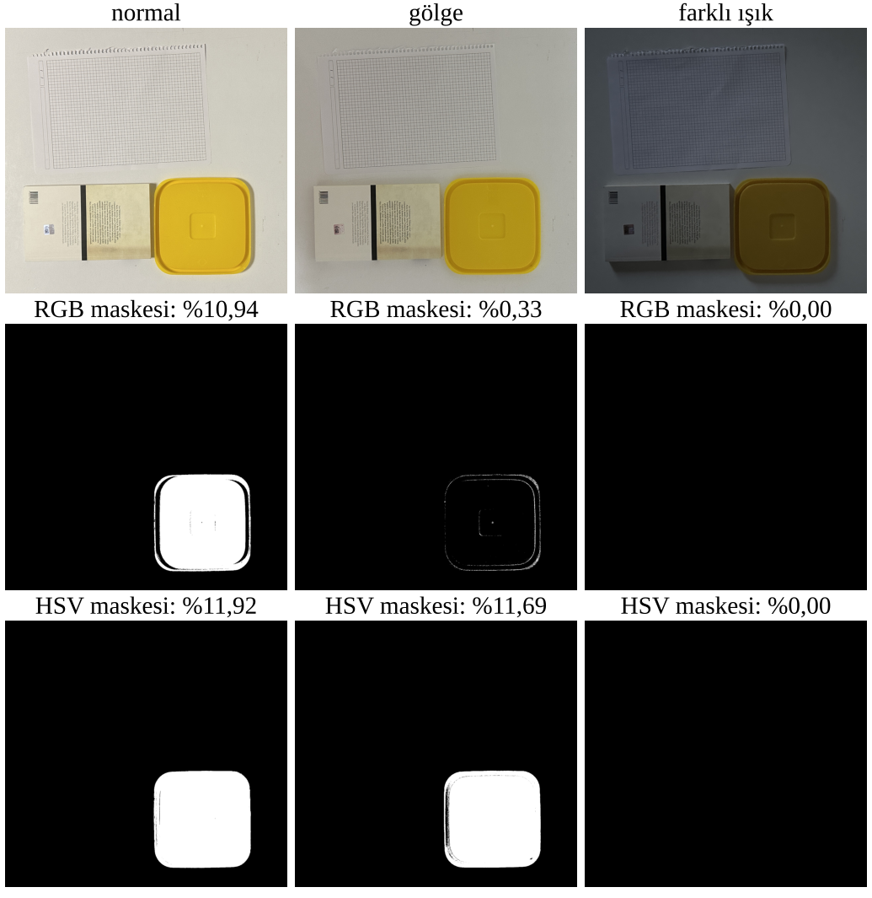
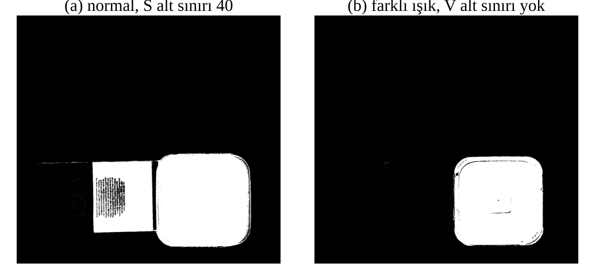
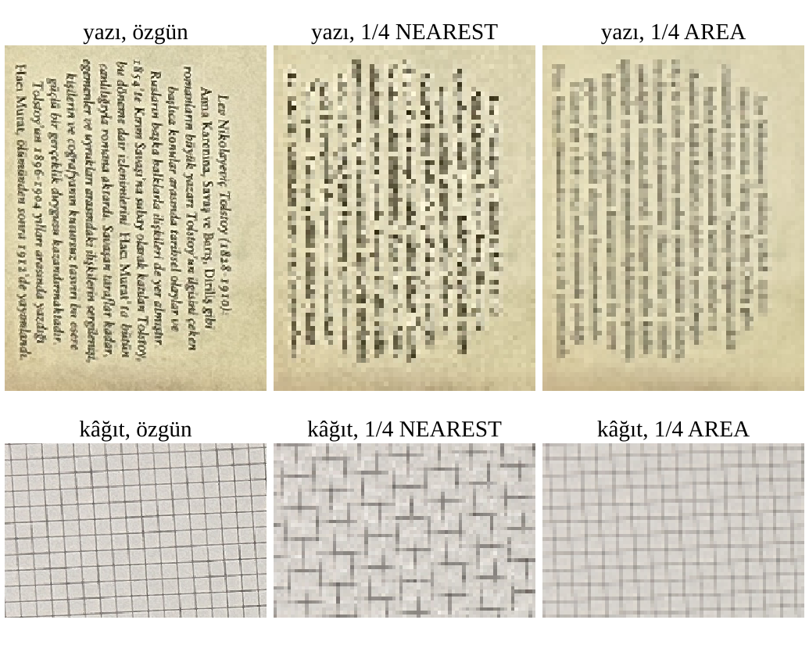

# YZM411 Ödev 1: Renk, aydınlatma ve örnekleme

Masamda kurduğum bir sahneyi üç ışık koşulunda çektim. Sarı bir kapağı normal ışıkta seçtiğim sabit RGB ve HSV eşikleriyle üç fotoğrafta maskeledim, parlaklık ve gama dönüşümlerini ölçtüm, sonra yazılı bir bölgeyi ve kareli kâğıdı 1/4'e küçültüp neyin kaybolduğuna baktım.

| | |
|---|---|
| Öğrenci | Safa Alp Bilge KILINÇ, 230212022 |
| Bölüm | Yapay Zeka Mühendisliği |
| Ders | YZM411 Bilgisayarlı Görü |
| Ders sorumlusu | Öğr. Gör. Melisa Gözet |
| Rapor | [230212022_rapor.pdf](230212022_rapor.pdf) (IEEE biçimi, 2 sayfa) |
| Defter | [230212022_defter.ipynb](230212022_defter.ipynb) |
| Sonuç tablosu | [ciktilar/sonuc_tablosu.csv](ciktilar/sonuc_tablosu.csv) |
| Kaynak beyanı | [KAYNAK_BEYANI.txt](KAYNAK_BEYANI.txt) |

## Sahne ve fotoğraflar

Sahnede hedef nesne olarak sarı bir kapak, küçük yazılı bir kitap ve kareli defter kâğıdı var. Üç fotoğrafı 1 Kasım 2026'da iPhone 14 Pro Max ile aynı konumdan, 1x ana kamerayla çektim. Dosyalar düzenlenmedi.

| Dosya | Koşul | Işık | Pozlama, ISO |
|---|---|---|---|
| `veri/IMG_1671.jpg` | normal | tavan lambası açık | 1/100 s, 200 |
| `veri/IMG_1673.jpg` | gölge | tavan lambası açık, sahnenin üstünde elimin gölgesi | 1/50 s, 250 |
| `veri/IMG_1670.jpg` | farklı ışık | tavan lambası kapalı, pencereden akşam ışığı | 1/17 s, 3200 |

Fotoğraflar 3024 × 4032 × 3, `uint8`. Pozlama ve beyaz dengesi otomatikti, bu yüzden telefon her karede ayarını kendisi değiştirdi. Sonuçları "yalnızca ışık değişti" diye okumamak gerekiyor. Masanın dışındaki eşyalar girmesin diye üç fotoğrafa aynı kesiti uyguladım (1700 × 1600 piksel). Faz korelasyonuyla ölçtüğüm kayma gölgede (0,71; −1,14), farklı ışıkta (−0,12; 0,50) piksel, yani aynı koordinat üç karede yaklaşık aynı noktaya düşüyor.



## Çalıştırma

```
pip install -r requirements.txt
jupyter notebook 230212022_defter.ipynb
```

Defteri Kernel > Restart & Run All ile baştan sona çalıştırın. Fotoğraflar `veri/` klasöründen okunuyor, bütün görseller ve CSV dosyaları `ciktilar/` klasörüne yeniden yazılıyor. Ben Python 3.13 ile çalıştırdım. Paket sürümleri `requirements.txt` dosyasında ve defterin ilk hücresinin çıktısında var. Koordinatlar ve eşik payları "Parametreler" hücresinde, değiştirmek isteyen oradan değiştirebilir.

## Klasör yapısı

```
├── README.md
├── 230212022_defter.ipynb    defter (bütün kod ve tahminler)
├── 230212022_rapor.pdf       rapor
├── KAYNAK_BEYANI.txt
├── requirements.txt
├── veri/                     üç özgün JPEG
└── ciktilar/
    ├── sonuc_tablosu.csv     bütün deneylerin özeti
    ├── esikler.json          dondurulan RGB ve HSV eşikleri
    ├── adim4_pikseller.csv   üç noktanın üç koşuldaki RGB değerleri
    ├── adim5_*.csv           maske alan oranları, HSV medyanları, kontrol maskeleri
    ├── adim6_donusumler.csv  parlaklık ve gama ortalamaları
    ├── adim7_*.csv           küçültme, PSNR, çizgi sayımı ve eşik duyarlılığı
    ├── maske_*.png           altı ham maske
    └── 01–06_*.png, rapor_sekil*.png
```

## Yöntem

Defter ödevdeki adımları sırayla izliyor. Her deneyden önce "Tahminim" başlığı altında ne beklediğimi yazdım.

Adım 4'te görüntünün boyutunu, türünü ve değer aralığını yazdırıyorum. Sarı kapak, beyaz masa ve kitap kapağı üzerindeki üç noktanın RGB değerlerini üç fotoğrafta ölçüyorum. NumPy erişiminin `img[y, x, kanal]` olduğunu ve OpenCV'nin BGR okuduğunu aynı piksel üzerinde gösteriyorum: kapakta BGR `[45, 185, 224]`, RGB'ye çevirince `[224, 185, 45]`.

Adım 5'te eşikleri yalnızca normal karedeki 100 × 100 piksellik kapak bölgesinden seçtim: her kanalın %2 ve %98 yüzdeliklerini alıp pay bıraktım, sonra donduruldu. Diğer iki fotoğraf için eşikleri yeniden ayarlamadım.

| Uzay | Alt sınır | Üst sınır |
|---|---|---|
| RGB | R 189, G 151, B 9 | R 250, G 212, B 69 |
| HSV (OpenCV, H 0–179) | H 18, S 165, V 154 | H 29, S 255, V 255 |

Alan oranı, seçilen piksel sayısının kesit alanına (2.720.000 piksel) oranı. Doğruluk ölçütü olarak kullanmadım, sadece maskenin ne kadar küçüldüğünü ya da kaydığını gösteriyor.

Adım 6'da dönüşümleri float64 üzerinde yapıp sonucu 0–255 aralığına kırptım. Parlaklık için `J = I + 40`, gama için `J = 255 · (I / 255)^γ` kullandım. γ formüldeki üs: γ = 0,5 açıyor, γ = 2,0 koyulaştırıyor.

Adım 7'de yazı kesitini (228 × 300) ve kareli kâğıdı (600 × 400) `INTER_NEAREST` ve `INTER_AREA` ile 1/4'e küçülttüm. Sonra sadece göstermek için en yakın komşuyla özgün boyuta büyüttüm.

## Sonuçlar

Üç noktanın RGB değerleri:

| Nokta (x, y) | Normal | Gölge | Farklı ışık |
|---|---|---|---|
| Sarı kapak (1000, 1350) | 224, 185, 45 | 179, 148, 31 | 68, 53, 14 |
| Beyaz masa (1550, 600) | 206, 204, 192 | 171, 171, 163 | 79, 83, 86 |
| Kitap kapağı (800, 1350) | 201, 188, 146 | 157, 146, 114 | 59, 59, 51 |

Maskelerin alan oranı:

| Koşul | RGB | HSV |
|---|---|---|
| Normal | %10,94 | %11,92 |
| Gölge | %0,33 | %11,69 |
| Farklı ışık | %0 | %0 |

Gölgede kapağın R değeri 179'a, yani RGB alt eşiğinin (189) altına indi, RGB maskesinde yalnızca kapağın parlak kenarı kaldı. HSV'de kapağın tonu ve doygunluğu aralıkta kaldığı için maske neredeyse aynı çıktı. Loş pencere ışığında iki maske de sıfırlandı. Kapağın tonu 22 ve doygunluğu 197 ile hâlâ aralıktaydı, onu maskeden atan 71'e düşen V oldu. V alt sınırını kaldırınca kapağı saran kutunun %90,5'i seçildi.



Bir kontrol daha yaptım. Kitabın krem kapağının tonu 25, sarı kapağınki 24. Bu eşiklerde ikisini S alt sınırı ayırıyor (medyan S 55 ve 210). S alt sınırını 40'a indirince krem kapak bütünüyle seçildi ve kutunun dışında 167.208 piksel maskeye girdi.

Parlaklık ve gama, kesit ortalaması 193,44:

| İşlem | Tahmin | Ölçüm | 255'i aşıp kırpılan |
|---|---|---|---|
| b = +40 | 233,44'ün biraz altı | 232,15 | %18,39 |
| γ = 0,5 | 222,10 | 220,07 | %0 |
| γ = 2,0 | 146,74 | 153,17 | %0 |

+40'ta artışın 40'tan 1,29 eksik kalmasının nedeni kırpma. Gamada tahmini formülü ortalamanın kendisine uygulayarak yaptım. Eğri dışbükey olduğu için piksellerin dönüştürülmüş ortalaması, ortalamanın dönüştürülmüş hâline eşit değil. γ = 2,0'daki +6,4'lük sapma buradan geliyor.

Küçültme:

| Bölge | Yöntem | PSNR (dB) | Dikey çizgi sayısı (özgün 33) |
|---|---|---|---|
| Yazı | INTER_NEAREST | 14,50 | |
| Yazı | INTER_AREA | 17,36 | |
| Kareli kâğıt | INTER_NEAREST | 17,71 | 14 |
| Kareli kâğıt | INTER_AREA | 20,59 | 23 |

Yazının satır aralığını FFT ile 14,25 piksel ölçtüm, küçültünce 3,6 piksele iniyor ve yazı iki yöntemde de okunmuyor. Büyütme kaybolan ayrıntıyı geri getirmiyor, sadece 57 × 75 pikseli 4 × 4'lük karelere kopyalıyor. En yakın komşu her 4 × 4 bloktan tek piksel aldığı için ince ızgara çizgilerini atlıyor ve düzensiz bir desen (örtüşme) üretiyor. Alan ortalaması çizgileri griye çeviriyor. Alan ortalamasında görselde bütün çizgiler duruyor ama 23 tane saydım. Sayım eşiğinin katsayısını 0,5'ten 0,3'e indirince 33'ün hepsi sayıldı, yani silikleşen çizgileri eşik kaçırıyordu.



## Tahminlerim nasıl çıktı

| Adım | Tahmin | Sonuç |
|---|---|---|
| 4 | Gölgede değerler en fazla %10 düşer | Tutmadı, kapakta ve masada düşüş %17–20 |
| 4 | Pencere ışığında masada B, R'yi geçer | Tuttu, masa (79, 83, 86) |
| 5 | Gölgede iki maske de normale yakın kalır | RGB'de tutmadı (%0,33), HSV'de tuttu |
| 5 | Farklı ışıkta RGB maskesi kaybolur | Tuttu |
| 5 | Farklı ışıkta HSV yarıdan fazla küçülür ama RGB'den çok piksel tutar | Yarısı tuttu, iki maske de sıfırlandı |
| 6 | +40 ortalamayı 40'tan biraz az artırır | Tuttu, +38,71 |
| 6 | γ = 0,5 açar, γ = 2,0 koyulaştırır | Yön tuttu, γ = 2,0'da sayı 6,4 saptı |
| 7 | Yazı iki yöntemde de okunmaz olur | Tuttu |
| 7 | En yakın komşu sahte desen üretir, alan ortalaması çizgileri griye çevirir | Tuttu |

## Sınırlar

Pozlama ve beyaz dengesi otomatikti. Gölge karesinde telefon pozlama süresini iki katına çıkardı, farklı ışık karesinde ISO 3200'e çıktı. Farklı ışık karesinde ışığın hem rengi hem şiddeti değişti. Elimin gölgesi sahneye eşit düşmedi. Çekimi AE/AF kilidiyle tekrarlamak bu etkiyi ayırırdı. Sonuçlar tek sahne ve tek nesneden geliyor.

## Kaynaklar

1. R. Szeliski, *Computer Vision: Algorithms and Applications*, 2. baskı, Springer, 2022, §2.3.1.
2. R. C. Gonzalez ve R. E. Woods, *Digital Image Processing*, 4. baskı, Pearson, 2018, §2.3.
3. M. Gözet, YZM411 Bilgisayarlı Görü, Hafta 1–2 ders notu, 2026–2027 Güz dönemi.
4. G. Bradski, "The OpenCV library," *Dr. Dobb's J. Softw. Tools*, 2000.
